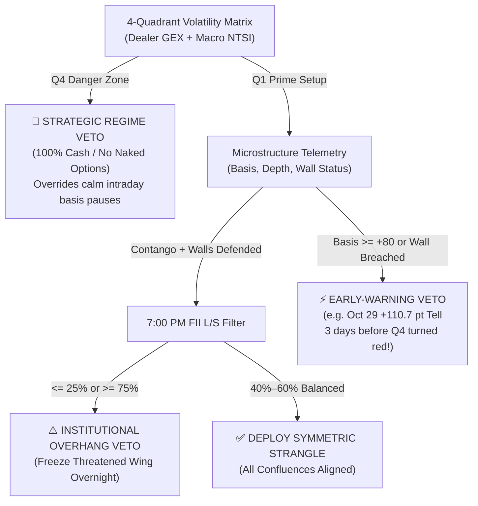

# Microstructure Radar & Volatility Matrix — Complete Interpretation Guide

A practical, trader-focused field manual explaining every banner, metric tile, chart, table, and decision framework inside the **Microstructure Radar** tab of the **OTM Option Screener Studio**.

> **Who is this for?**  
> Option sellers (strangle, credit spread, and iron condor writers) who want to understand *when* probability strongly favors theta decay, *when* institutional order flow warns of a stealth squeeze/cascade before price breaks out, and *how* to combine every panel into a 3-minute daily routine.

---

## 1. Decision Primacy Hierarchy: Telemetry vs. 4-Quadrant Matrix

A frequent question when monitoring both tabs simultaneously is: **Which section takes priority if they ever seem to emphasize different risks?**

The system uses a **Two-Tier Command Hierarchy** connected by an **Asymmetric Veto Interlock**:
- **Selling Symmetric Strangles is an `AND` Gate:** *All* layers (Quadrant 1 + Calm Microstructure + Balanced FII Inventory) must confirm safety.
- **Vetoing / Standing Aside is an `OR` Gate:** A red flag in *any* critical layer blocks naked option selling immediately.

### When Each Section Holds Primacy

| Market Phase | Which Section Leads? | Why & Real-World Example |
| :--- | :--- | :--- |
| **1. Quiet Market Coiling for a Breakout** *(Transition from Range $\rightarrow$ Trend)* | **Microstructure Telemetry** *(Early-Warning Primacy)* | Daily technical indicators in NTSI (ADX, Choppiness Index, 5-Day Return) lag by 1–3 sessions. On **Oct 29, 2026**, the 4-Quadrant Matrix was still green in Quadrant 1 (`NTSI = 80`), yet **Futures Basis** spiked to **`+110.65 pts`**. Telemetry immediately flashed `VETO NAKED CALLS` **3 trading days before** Spot broke out $+2,331$ pts. **Telemetry overrules Q1’s green light.** |
| **2. Active Runaway Trend / Mid-Rally Pause** *(Sustained Breakout or Cascade)* | **4-Quadrant Volatility Matrix** *(Regime Primacy)* | During a multi-day trend, intraday Futures Basis can temporarily cool back into normal `+40 to +55 pts` Contango and order book depth can balance at `1.18x`. On **Nov 11, 2026** (`Spot 25,304`, `5d Return +5.65%`), intraday basis looked balanced (`+47.65 pts`), **but Spot was `+305 pts` above the `25,000 CE` Call Wall (`-830 Cr -GEX`) and `NTSI` was `34.0` (Quadrant 4)**. **Never let a calm intraday pause lure you back into naked strangles while Quadrant 4 is active.** |
| **3. Overnight Risk Check (19:00 IST)** | **7:00 PM NSE FII/DII Telemetry** | Reveals *who* owns the open interest. Even if closing spot settles inside boundaries, **FII Index Futures L/S $\le 25\%$** means massive institutional short leverage will cause violent market-open short covering on any overnight gap-up. |

---

## 2. Header Bar, Controls & Automatic Session Sync

1. **`⚡ Run Microstructure Radar (Fast)`**:
   - Dispatches **1 single batch quote** (`getMarketData('FULL')`) covering NIFTY near-month Futures, 10 key ATM±500 Call/Put boundary strikes, plus the tracked replay wings (`24,850 CE` / `21,050 PE`).
   - Also backfills/updates [`microstructure_replay_past_week.csv`](file:///c:/Users/mrigt/Documents/mrig_new_laptop/python%20coding/korefinz%20americas/antigravity/nifty_analysis/microstructure_replay_past_week.csv), triggers a **live NSE 7:00 PM FII/DII participant sync**, and regenerates the 4-panel PNG chart.
2. **`Run Full Pipeline`**:
   - Executes the complete daily workflow sequentially:
     1. [`nifty_option_seller.py`](file:///c:/Users/mrigt/Documents/mrig_new_laptop/python%20coding/korefinz%20americas/antigravity/nifty_analysis/nifty_option_seller.py) (updates `yfinance`/Spot daily candles, calculates full 5-pillar **NTSI** score, identifies 95% confidence strikes, and appends/updates the **`nifty_option_seller_daily`** Google Sheet tab).
     2. [`nifty_microstructure_radar.py`](file:///c:/Users/mrigt/Documents/mrig_new_laptop/python%20coding/korefinz%20americas/antigravity/nifty_analysis/nifty_microstructure_radar.py) (updates live telemetry JSON, flow replay CSV, and **`nifty_microstructure_radar`** Google Sheet tab).
     3. [`participant_service.py`](file:///c:/Users/mrigt/Documents/mrig_new_laptop/python%20coding/korefinz%20americas/antigravity/otm_option_screener/backend/participant_service.py) (refreshes official NSE `fao_participant_oi` data).
     4. [`plot_microstructure_replay.py`](file:///c:/Users/mrigt/Documents/mrig_new_laptop/python%20coding/korefinz%20americas/antigravity/nifty_analysis/plot_microstructure_replay.py) (regenerates high-res PNG).
3. **`Sync 7:00 PM NSE Data`**:
   - On-demand download & parser for `archives.nseindia.com/content/nsccl/fao_participant_oi_{DDMMYYYY}.csv` (with automatic fallback walking back up to 7 days on weekends/holidays).
4. **`4-Panel PNG Chart`**:
   - Opens the 200 DPI publication-grade Matplotlib summary modal.
5. **Default View Auto-Sync (`ensure_current_session_data`)**:
   - On server startup (`python run_app.py`) and initial tab load (with a 180s cooldown lock), the backend checks whether local telemetry and replay flow files are behind the latest completed or active NSE session. It parses the broker’s `exchTradeTime` timestamp so:
     - **During Live Market Hours**: Shows `Live / Today Session` with today’s date.
     - **On Weekends / Trading Holidays**: Cleanly stamps **`Last Completed Session (YYYY-MM-DD)`** (e.g., `2026-11-09` when `2026-11-10` is a holiday) alongside `Synced: ... IST`, so charts never invent phantom holiday bars or stall on outdated days.

---

## 3. Top Executive Directive Banner & 6-Tile Telemetry Strip

### A. Master Executive Directive Banner
Located prominently at the top so your eye catches the net verdict in 1 second:
- **Emerald (`SYMMETRIC STRANGLE APPROVED — ALL CONFLUENCES ALIGNED`)**: Q1 is active (`+GEX`, `NTSI >= 60`), Futures Basis is inside healthy Contango, walls are safely `> 1.8%` away, and FIIs are balanced (`40%–60%`). Safe to write balanced OTM strangles.
- **Rose (`VETO NAKED CALLS` / `STAND ASIDE / 100% CASH`)**: Either Telemetry detected an upside Call Wall breach / Basis spike (`>= +80 pts`), **or** the 4-Quadrant Matrix sits in **Quadrant 4 (`Danger Zone`)**, **or** FII L/S Ratio is $\le 25\%$. Close threatened short Calls at `2.0x` stop or stay in 100% Cash / defined Bull Put Spreads.
- **Amber (`VETO NAKED PUTS` / `CREDIT SPREADS ONLY` / `CAUTION Q2`)**: Either Basis dropped into panic backwardation (`< -20 pts`), Spot breached/pressured the Put Wall, Quadrant 2/3 is active, or FII L/S Ratio is $\ge 75\%$.

### B. The 6 Telemetry Metric Tiles

| Tile | What It Shows | Green / Safe Zone | Warning / Hazard Threshold |
| :--- | :--- | :--- | :--- |
| **1. NIFTY Spot / VIX** | Current underlying index & India VIX implied volatility gauge. | VIX **`13.0 – 17.5`** (Sweet Spot: rich enough VRP without systemic panic). | **VIX $> 19.0$**: High-volatility tail regime—stand aside. **VIX $< 12.0$**: Option premiums too cheap for overnight gap risk. |
| **2. Futures Basis** | $\text{Near Futures LTP} - \text{Spot}$ (points and `%`). Institutions express large directional bets in Futures first. | **`+20 to +50 pts`** (`+0.10% to +0.25%`) *Normal Contango* — balanced carry. **`-20 to +20 pts`** *Mild/Tight Spread*. | **`>= +80 pts` (`>= +0.35%`)**: Aggressive long accumulation **Squeeze Alert** $\rightarrow$ Veto Calls. **`< -20 pts`**: Institutional hedging discount **Panic Alert** $\rightarrow$ Veto Puts. |
| **3. Futures Depth Ratio** | Limit order book $\frac{\text{Total Buy Quantity}}{\text{Total Sell Quantity}}$ on NIFTY Futures. | **`0.8x – 1.8x`** Balanced two-way institutional liquidity. | **`>= 2.5x`**: *Bullish Overdrive* — buyers chasing liquidity. **`<= 0.6x`**: *Seller Overhang* — heavy supply overhead. |
| **4. Dominant Call Wall** | Highest Call Open Interest strike in the ATM $\pm 500$ corridor (`+dist%` = strike above spot; `-dist%` = spot already **above** strike). | **`DEFENDED`** (`> +1.8%` overhead buffer above spot). | **`UNDER TEST`** (`+0.0% to +1.8%`). **`HIGH ALERT`** (`<= +1.0%` & Buyers `>= 3.0x`). **`BREACHED / SQUEEZE`** (`dist <= 0%`: Spot blew past the Call Wall!). |
| **5. Dominant Put Wall** | Highest Put Open Interest strike in the ATM $\pm 500$ corridor. | **`DEFENDED`** (`> 1.8%` cushion below spot) or **`SUPPORT FLOOR ACTIVE`** (holding below spot during an active contango rally). | **`UNDER TEST`** (`<= 1.2%` buffer with negative basis/momentum). **`BREACHED / CASCADE`** (`Spot <= Put Wall`: Market fell below major support!). |
| **6. Near Futures** | Active front-month futures ticker (`NIFTY23NOV26FUT`) & LTP. | Confirms contract liquidity and roll schedule. | Verify contract rollover within final 3 days before monthly expiry. |

---

## 4. Sub-Tab 1: Microstructure Telemetry & Flow Radar

### A. Chart 1 — Lead Squeeze Signal: Spot vs. Futures Basis
Plots **NIFTY Spot** (dark/white solid line, left Y-axis) against **Futures Basis** (both translucent bars **and** thin red overlay line, right Y-axis).
- **Red Shaded Zone (`> +80 pts`)**: Institutional Long Accumulation Zone. Watch how **Oct 29 (`+110.65 pts`)** spiked into the red zone while Spot had barely moved (`22,936`).
- **Green Shaded Zone (`+20 to +50 pts`)**: Equilibrium theta-capture zone.
- **Zero Dashed Line (`0 pts`)**: Below `0` means Futures trade at a discount to Cash (*Backwardation*).

### B. Chart 2 — Call Wing Squeeze vs. Put Wing Decay Curve
Tracks a real benchmark OTM strangle entered during calm conditions (**`24,850 CE` @ ₹5.50** vs **`21,050 PE` @ ₹36.95**) to illustrate option convexity in action:
- **Scale Switcher (`Zoom Tilt 0-45`, `Log`, `Linear`)**:
  - Use **`Zoom Tilt (0-45)`** by default to clearly see the early curl from ₹5.50 $\rightarrow$ ₹10.10 $\rightarrow$ **`₹12.60` (`2.0x` Hard Stop Line)** before convexity explodes vertically (`₹174` $\rightarrow$ `₹433` $\rightarrow$ `₹625+`). Clipped spikes show an upward red triangle (`▲ ₹626`) so early scaling isn't squashed.
  - Switch to **`Log`** or **`Linear`** to appreciate the full logarithmic blowup magnitude.
- **Blue Dashed Line (`₹12.60`)**: **Non-Negotiable `2.0x` Hard Stop**. Notice on Nov 03 that cutting the Call when premium doubled saved the position from a ₹600+ catastrophe.
- **Amber Dashed Line (`₹9.75`)**: **`50%` Profit Target Lock**. Closing the profitable Put wing early at 50% decay captures bulk ROC without sitting through late-cycle tail risk.

### C. Replay Period Toolbar & Audit Table
- **Period Filter Chips**: Switch between **`All Sessions (10-27 – Latest)`**, **`Oct 27–30 (+110pt Basis Spike)`**, **`Nov 02 – Latest (Execution & Live)`**, **`Last 5 Days`**, and **`Last 3 Days`**.
- **Hover Synchronization**: Moving your mouse over any bar, dot, or audit table row highlights that exact date across Chart 1, Chart 2, and both chart footers simultaneously.
- **Replay Audit Table (`Disciplined P&L` vs `Blind Hold P&L`)**: Audits every trading day, comparing disciplined execution (`+₹518.75/lot` locked profit via `2x` Call stop + `50%` Put target) against passive hope (`-₹14,671+/lot` blowout).

### D. Operational Timing, Cheat Codes & 4-Panel PNG
- **Timing Guide**: Explains why **10:00–10:30 AM IST** is best for deploying today's trades (after `9:15–9:45 AM` opening MOO noise settles), **1:00–1:30 PM IST** catches European open shifts, **3:45–4:30 PM IST** finalizes EOD planning for tomorrow, and **7:00 PM IST** releases institutional FII inventory.
- **Cheat Codes Accordion**: Four instant reference tabs (**`3 Basis Regimes`**, **`3 Core Rules`**, **`4-Quadrant Matrix`**, **`Smart Money Guide`**).

---

## 5. Sub-Tab 2: 4-Quadrant Volatility Matrix (`GEX` vs. `NTSI`)

### A. Understanding the 2D Cartesian Decision Map

- **Horizontal Axis ($X$): Dealer Gamma Exposure (GEX)** centered on the **Gamma Flip Level ($S^*$)** (skew-weighted OI midpoint between dominant Call Wall and Put Wall).
  - **Right Side (`+GEX > 0`) — Shock Absorber**: Market makers are net long gamma. When Nifty rises, dealers *sell* futures to stay delta-neutral; when Nifty falls, dealers *buy* futures. Volatility is structurally dampened.
  - **Left Side (`-GEX < 0`) — Volatility Accelerator**: Spot is testing/beyond the Call Wall or below the Put Wall/Gamma Flip. Dealers are net short gamma and must *buy into rallies* and *sell into crashes*, fueling trend acceleration.
- **Vertical Axis ($Y$): Macro NTSI Score (`0 – 100`)** centered on the **Safety Cutoff (`60`)**.
  - **Top Half (`NTSI >= 60`)**: Low directional velocity; range-bound indicators favor mean reversion.
  - **Bottom Half (`NTSI < 60`)**: Active directional momentum (ADX rising, wide BBW, strong 5-day return).

### B. Reading the 4 Quadrants

| Quadrant | Coordinates | Market Physics | Option Seller Win Rate | Required Action |
| :--- | :--- | :--- | :---: | :--- |
| **Q1: Prime Setup** *(Seller's Paradise)* | **Top-Right** (`+GEX` & `NTSI >= 60`) | Calm technicals + dealer dampening cushion. | **95% – 98%** | **DEPLOY FULL SYMMETRIC STRANGLE** (`~40–55 DTE`, `+10.5% CE / -10.0% PE`, `2.0x` stop). |
| **Q2: Deceptive Range** *(Coiling Squeeze)* | **Top-Left** (`-GEX` & `NTSI >= 60`) | Superficial calm masking negative dealer gamma. | **55% – 65%** | **STAND ASIDE OR WIDEN TO $\ge \pm 14.5\%$ OTM** (Defined Iron Condors only). |
| **Q3: Mean Reversion** *(Buffered Trend)* | **Bottom-Right** (`+GEX` & `NTSI < 60`) | Trend active, but heavy wall OI caps extension. | **80% – 88%** | **SELL CREDIT SPREADS AWAY FROM TREND** (e.g., Bull Put Spreads on supported dips). |
| **Q4: Danger Zone** *(Seller's Graveyard)* | **Bottom-Left** (`-GEX` & `NTSI < 60`) | Runaway trend + forced dealer chasing (`-GEX`). | **$< 35\%$** | **100% CASH / VETO ALL NAKED OPTIONS**. Cut threatened wings strictly at `2.0x`. |

### C. Interactive Map Features & Scenario Simulator
- **Historical Replay Path**: Toggle the cyan dashed trail on/off to see how Nifty migrated chronologically from Q1 (`Oct 27`) into Q4 (`Nov 02 – Current`).
- **Next-Day Session Scenario Projection**: Click **`+1.0% Squeeze`**, **`+0.4% Drift`**, **`Flat / Pin`**, or **`-0.8% Dip`** to plot where tomorrow’s market open (`dashed projection node`) would land on the 4-Quadrant plane, what wall strikes would break, and what defensive trades apply.
- **Recommended Option Seller Playbook**: Displays exact recommended structure, strike targets, approximate deltas, and hard stop / circuit breaker rules for the prevailing quadrant.

---

## 6. NSE 7:00 PM Institutional Participant Telemetry Card

Located inside the **4-Quadrant Volatility Matrix** tab (with an inline **`Field Guide (FII / DII)`** expander):

1. **FII (Foreign Institutional Investors)**:
   - Track the **FII Futures Long/Short Ratio Bar**:
     - **$\le 25\%$**: *Extreme Short Saturation* $\rightarrow$ Short-Squeeze Hazard (**Veto Naked Calls**).
     - **$40\%\text{--}60\%$**: *Balanced Equilibrium* $\rightarrow$ Clean strangle environment.
     - **$\ge 75\%$**: *Long Exhaustion Top* $\rightarrow$ Cascade Pullback Hazard (**Veto Naked Puts**).
2. **PRO (Proprietary Desks / Market Makers)**:
   - PROs stay delta-neutral. **PRO Net Calls $> 0$ & PRO Net Puts $< 0$** confirms market makers bought calls / sold puts to clients and must **buy dips** (`+GEX` floor support). The reverse confirms `-GEX` selling pressure.
3. **CLIENT (Retail Participants)**:
   - Contrarian overcrowding alarm. Large negative retail Net Puts (`-300k` to `-500k+`) signal retail put-writers exposed to forced 10:00 AM broker margin liquidations on any sharp gap-down.
4. **DII (Domestic Mutual Funds & Insurers)**:
   - SEBI rules prohibit mutual fund speculative index shorting; persistent net long puts represent routine equity portfolio disaster insurance—treat as **neutral baseline noise**.

---

## 7. Daily 3-Minute Option Seller Routine

1. **10:00 AM IST (Post-Opening Noise)**: Click **`⚡ Run Microstructure Radar (Fast)`**. Check **Master Executive Directive**, **4-Quadrant Position**, and **Call/Put Wall Statuses**. Only deploy new short strangles if **both** Q1 is active and Telemetry/FII show green confluences.
2. **01:15 PM IST (European Open Check)**: Refresh radar (`~0.35s`) to ensure neither short wing has approached `2.0x` entry premium and Futures Basis hasn’t broken threshold (`+80` or `-20`).
3. **03:55 PM IST (EOD Next-Day Prep)**: Click **`Run Full Pipeline`** (updates Google Sheets + finalizes NTSI daily candle) and test tomorrow’s scenarios (`+1.0%`, Flat, `-0.8%`) in the **Next-Day Scenario Simulator**.
4. **07:05 PM IST (Inventory Verification)**: Click **`Sync 7:00 PM NSE Data`** and verify FII L/S Ratio (`25% / 75%` bounds) and Client Net Puts before leaving overnight risk open.

